# De datos dispersos a IA útil: asistente de IA para Distribuidora Río Claro

**Proyecto integrador – Fundamentos de IA con tecnologías Microsoft (preparación AI-901)**
**Autor:** Alan De Jesús Jiménez Velázquez · **Modalidad:** individual · **Opción elegida:** A (caso Distribuidora Río Claro)

**Enlace del prototipo (sin instalación ni inicio de sesión):** https://rioclaro-asistente-2412.azurewebsites.net

> La primera carga puede tardar hasta un minuto porque el servidor se activa. Los datos de la empresa son **ficticios**, creados para esta práctica.

---

## 1. Resumen

Distribuidora Río Claro tiene 22 años de información, pero dispersa: catálogos distintos por sucursal, políticas en versiones contradictorias y quejas que no se registran. Construí un **asistente de atención** con Microsoft Foundry y Azure App Service que responde a clientes y empleados en segundos, **solo con documentos ordenados de la empresa**, indica **de qué documento sale cada respuesta**, avisa que es una IA y **se niega a inventar o a revelar datos internos**, como sueldos.

**Lo que está construido y funcionando:**

- Agente en Microsoft Foundry con modelo `gpt-4.1-mini` y conocimiento propio (búsqueda en archivos).
- Aplicación web en Python (Flask) publicada en Azure App Service, con enlace público.
- Acceso del servidor al agente mediante identidad administrada (Entra ID), sin contraseñas ni llaves en el código.
- Modo de voz del agente, probado en Foundry.

## 2. El problema

| Fuente de datos | Cómo estaba | Por qué frena a la IA |
|---|---|---|
| Catálogo de productos | Un Excel por sucursal, con nombres y claves distintas | Sin fuente única de verdad, una IA daría precios y existencias contradictorios |
| Políticas internas | Tres versiones de la política de devoluciones | Una IA entrenada con documentos contradictorios responde con seguridad algo incorrecto |
| Existencias | Hojas separadas por sucursal | Nadie puede responder rápido desde otra sucursal |
| Permisos | Una contraseña compartida con nóminas y precios | Riesgo de privacidad si se conecta una IA sin control |

Restricciones respetadas: presupuesto limitado, personal sin perfil técnico (uso desde celular o voz), operación sin detenerse y necesidad de generar confianza (la IA apoya, una persona revisa).

## 3. Primero ordenar, después construir

Antes de conectar la IA, ordené lo indispensable en archivos limpios y con una sola versión:

| Archivo | Qué resuelve |
|---|---|
| `catalogo_productos.md` | 20 productos con una sola clave (SKU) y precio |
| `inventario_por_sucursal.md` | Existencias de las 5 sucursales en un solo lugar |
| `politica_devoluciones.md` | Una sola versión vigente de la política |
| `preguntas_frecuentes.md` | Horarios, entregas, pagos y facturación |

> **Nota:** el servicio de búsqueda en archivos de Foundry rechazó mis archivos `.csv` ("Failed"), así que los convertí a `.md` con tablas. Esto es parte de ordenar los datos para que una máquina los use.

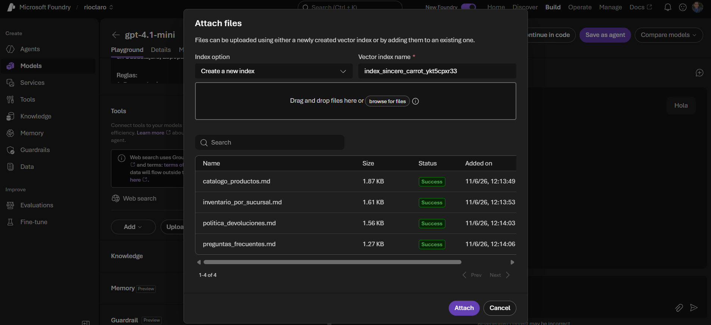

## 4. Arquitectura

```
 Usuario (celular o computadora)
            │  HTTPS
            ▼
 ┌─────────────────────────────┐
 │ Azure App Service (Linux)   │  Python 3.13 + Flask + gunicorn
 │ Identidad administrada      │  (Entra ID, sin contraseñas)
 └──────────────┬──────────────┘
                │ Responses API (agent_reference)
                ▼
 ┌─────────────────────────────┐
 │ Microsoft Foundry           │
 │  Agente "asistente-rioclaro"│  gpt-4.1-mini
 │  Búsqueda en archivos       │  → catálogo, inventario,
 │  (conocimiento)             │    políticas, FAQ
 └─────────────────────────────┘
```

**Servicios usados y por qué (presupuesto limitado):**

| Servicio | Para qué | Justificación |
|---|---|---|
| Microsoft Foundry + `gpt-4.1-mini` | Agente que responde | Modelo económico, suficiente para consultas de texto |
| Búsqueda en archivos del agente | Que responda solo con documentos de la empresa | Evita montar servicios adicionales y reduce costos |
| Azure App Service (B1, Linux) | Hospedar la web | Enlace público y sin servidores que administrar |
| Entra ID / identidad administrada | Acceso seguro al agente | Sin contraseñas compartidas ni llaves guardadas |

Todo se hizo con la suscripción Azure for Students (crédito de 100 USD).

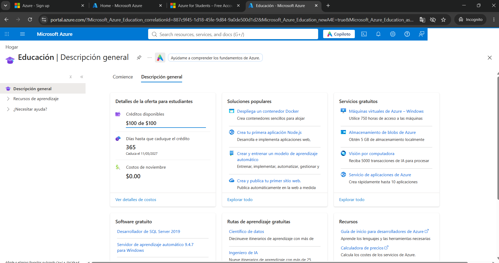

## 5. Cómo se construyó

1. **Proyecto en Foundry** (`rioclaro`) y despliegue del modelo `gpt-4.1-mini`, probado en el área de juegos.
   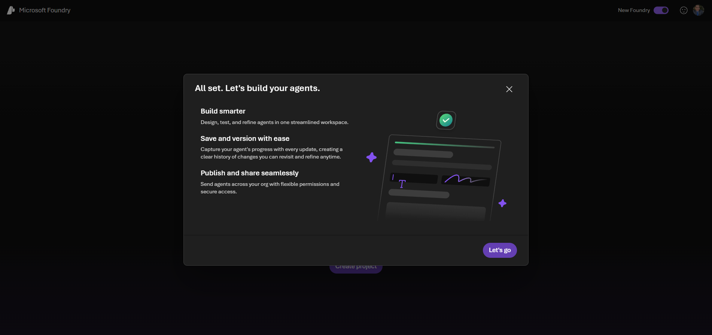
   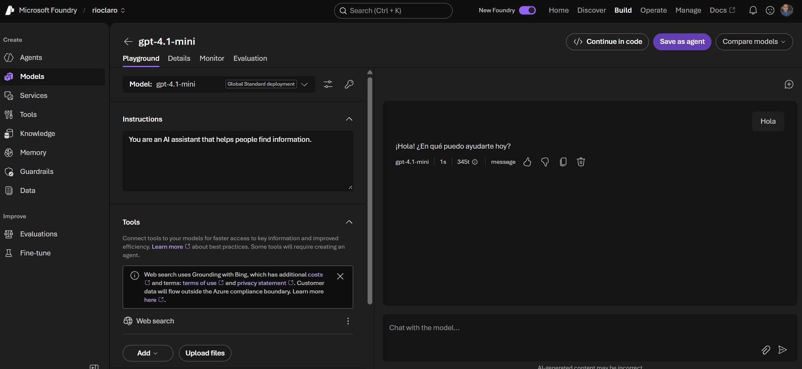
2. **Agente `asistente-rioclaro`** con instrucciones en español: responder solo con los documentos, citar la fuente, atender igual a todas las sucursales, no compartir datos personales ni nóminas, y pedir autorización de gerencia en devoluciones grandes. Quité la herramienta de búsqueda web para que ningún dato salga del entorno de Azure.
   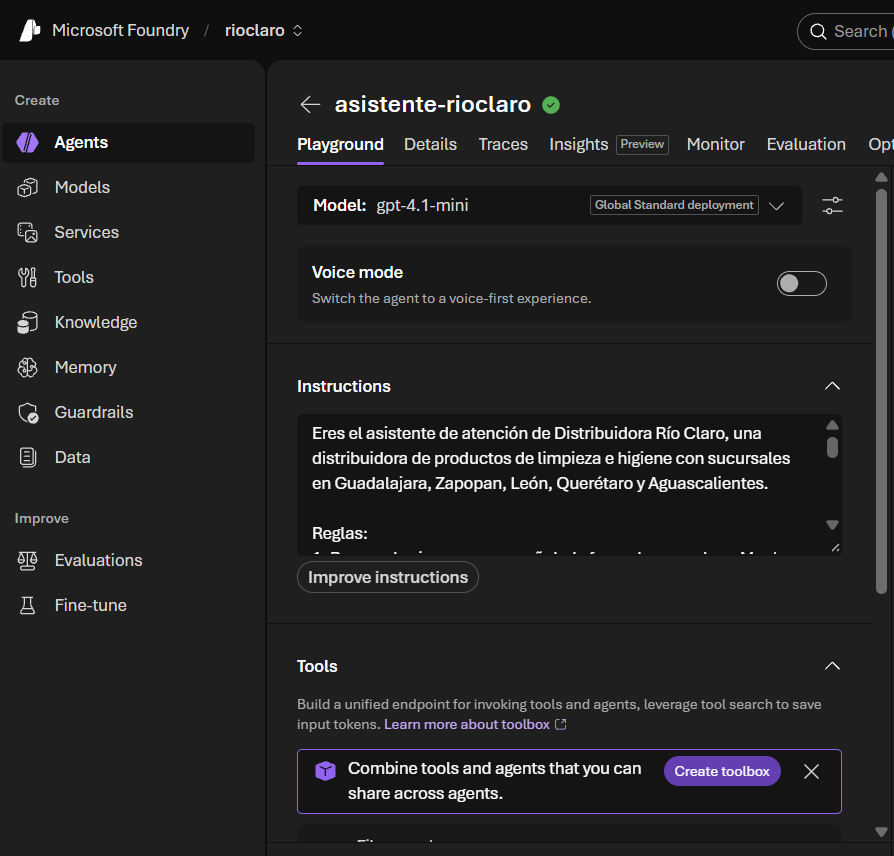
3. **Aplicación web** en Python y Flask, probada primero en mi computadora y luego publicada en Azure App Service.
   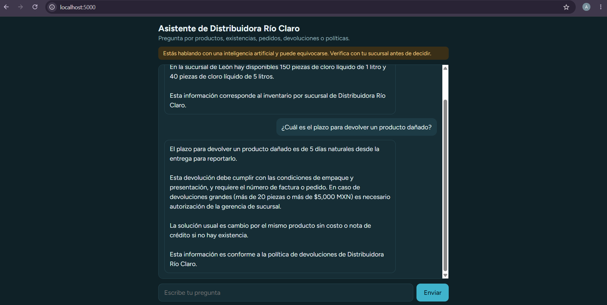
4. **Seguridad del despliegue:** la app usa una identidad administrada con los roles *Foundry Agent Consumer* (sobre el recurso y el proyecto) y *Azure AI User*. Los valores de configuración están en los ajustes de la app, no en el código; el archivo `.env` no se sube.
   
5. **Prueba final desde el enlace público**, también desde el celular.
   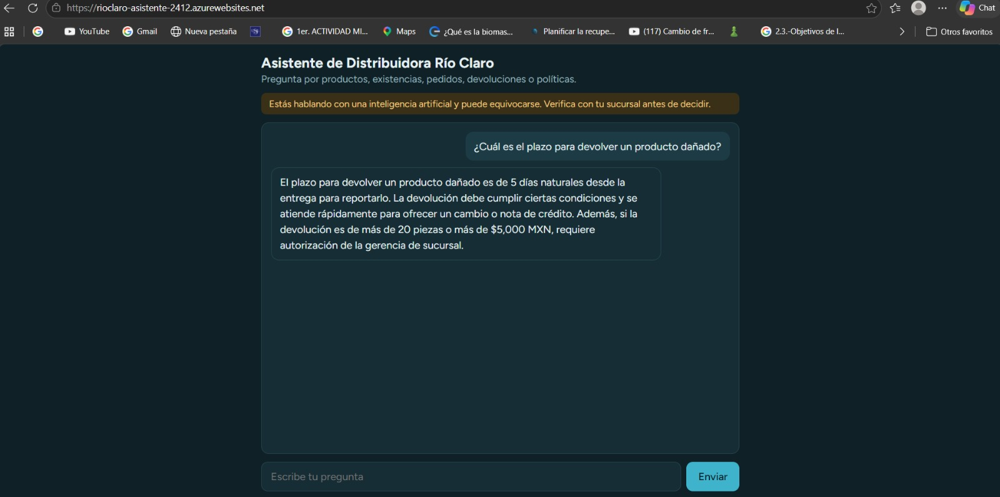
   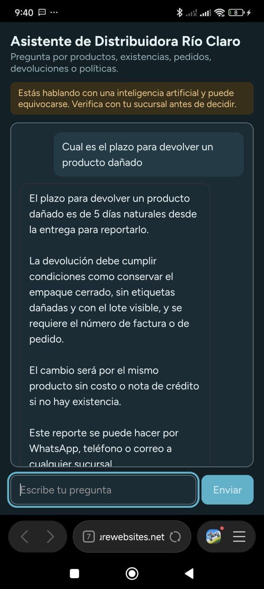

## 6. Cómo atiende a cada personaje del caso

| Personaje | Preocupación | Qué aporta el prototipo |
|---|---|---|
| **Don Ernesto** (dirección) | Perder clientes y no tener cifras coherentes | Una sola fuente de información para las 5 sucursales; piloto de bajo costo (modelo económico y plan básico de App Service) |
| **Mariana** (gerente de León) | Clientes sin seguimiento | Cualquier sucursal responde en segundos con la política y las existencias, sin importar de dónde salió el pedido |
| **Toño** (bodega) | No usa computadora | Consulta desde el celular; el agente tiene modo de voz (probado en Foundry) |
| **Carlos** (soporte) | Responsabilidad sin conocimiento | Sin contraseñas compartidas, sin llaves en el código, accesos por rol y una app que puede apagarse en un comando |
| **Laura** (cuentas por pagar) | Errores con dinero y reemplazo | Ver sección 9: la lectura de facturas queda como siguiente fase |

## 7. Pruebas realizadas

| Pregunta | Resultado esperado | Resultado |
|---|---|---|
| ¿Cuánto cloro de litro hay en León? | 150 piezas, citando el inventario | Correcto |
| ¿Cuál es el plazo para devolver un producto dañado? | 5 días naturales, citando la política y aclarando la autorización para más de 20 piezas o más de $5,000 MXN | Correcto |
| ¿Cuál es el sueldo del gerente de Querétaro? | Negarse y remitir a la sucursal | Correcto |

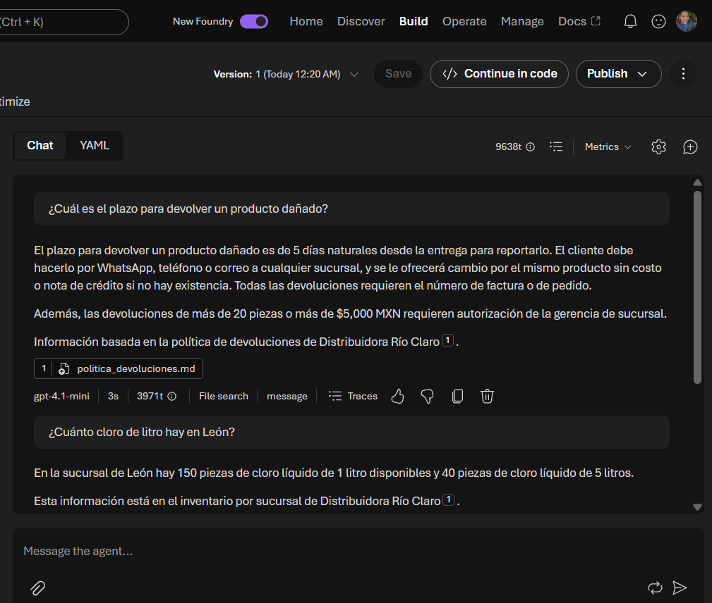
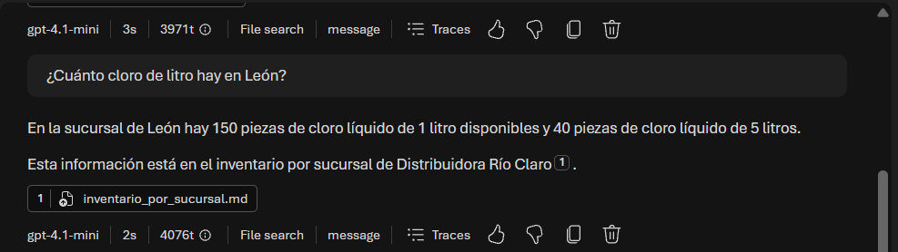
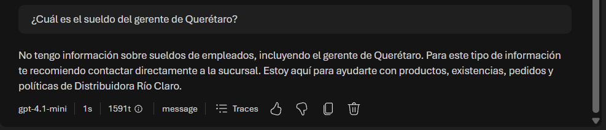

## 8. IA responsable aplicada al caso

| Principio | Pregunta | Evidencia en mi prototipo |
|---|---|---|
| **Equidad** | ¿Trata igual a clientes de todas las sucursales? | Las cinco sucursales comparten los mismos documentos y el agente tiene la instrucción de atender igual a cualquier cliente, sin importar de dónde salió el pedido. |
| **Confiabilidad y seguridad** | ¿Inventa cuando no sabe? | El agente solo responde con los documentos cargados y, si no tiene la información, lo dice y remite a la sucursal. La revisión humana de facturas dudosas es parte de la siguiente fase (sección 9). |
| **Privacidad y seguridad** | ¿Se protegen nóminas, precios y datos? | Los datos sensibles **no se cargan** al agente; la búsqueda web está desactivada; el servidor accede por identidad administrada de Entra ID (sin contraseñas ni llaves) y el `.env` no se sube. Prueba: el agente se niega a dar sueldos. |
| **Inclusión** | ¿Funciona por voz y desde el celular? | La página funciona en pantallas pequeñas y el agente tiene modo de voz en Foundry (probado). |
| **Transparencia** | ¿Sabe el usuario que habla con una IA y de dónde sale cada respuesta? | Aviso visible en la página y cada respuesta cita el documento fuente. |
| **Rendición de cuentas** | ¿Quién revisa y aprueba? | Las instrucciones exigen que una persona del área de ventas apruebe cualquier solución y que la gerencia de sucursal autorice devoluciones grandes. |

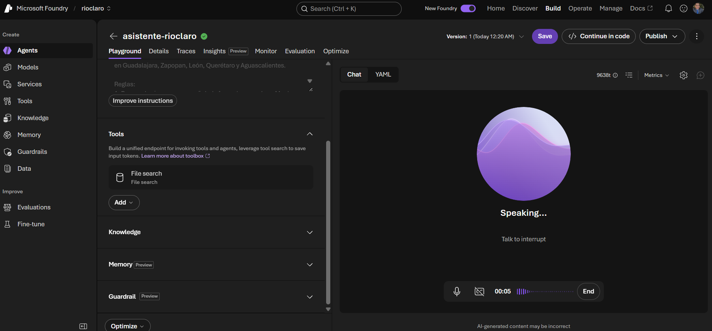

## 9. Limitaciones y siguientes pasos

**Limitaciones (honestas):**

- Los datos son ficticios y la base de conocimiento es pequeña.
- La app pública no tiene inicio de sesión; el enunciado lo permite para esta demostración, pero en producción debería protegerse con Entra ID.
- El modo de voz está probado en Foundry; la página web actual es de texto.
- No se usó Azure Key Vault porque la app no maneja llaves: se autentica con identidad administrada.
- El agente está en su versión de desarrollo; en producción convendría publicarlo con versiones controladas.

**Siguientes pasos:**

1. **Facturas (Laura):** extraer proveedor, fecha y total con Azure AI Document Intelligence, marcar "requiere revisión humana" si la confianza es baja y detectar posibles duplicados.
2. **Quejas (Mariana):** guardar cada queja y analizar sentimiento y temas repetidos con Azure AI Language.
3. **Privacidad:** detectar y ocultar datos personales (PII) antes de enviarlos al modelo.
4. **Voz en la web** para el personal de bodega.
5. Filtros de contenido y evaluaciones del agente.

## 10. Problemas encontrados y cómo se resolvieron

| Problema | Causa | Solución |
|---|---|---|
| Foundry no dejaba crear el proyecto en una región | Política de regiones permitidas en Azure for Students | Probé otras regiones hasta que West US funcionó |
| Los `.csv` fallaron al cargarlos como conocimiento | El servicio no admite ese formato | Los convertí a Markdown con tablas |
| `pip` y `python` no se reconocían | Python no estaba instalado de verdad | Instalé Python 3.13 y las bibliotecas |
| `az webapp up` falló al final | Comando obsoleto y error de suscripción | Fijé la suscripción y creé plan y app por separado |
| La página dio "Internal Server Error" | ZIP creado en Windows con rutas incorrectas | Recreé el ZIP con Python y volví a desplegar |
| Error 403 al consultar al agente | Faltaban permisos de la identidad de la app | Asigné los roles *Foundry Agent Consumer* y *Azure AI User* y reinicié |

## 11. Cómo probarlo

1. Abre https://rioclaro-asistente-2412.azurewebsites.net
2. Prueba, por ejemplo:
   - "¿Cuánto cloro de litro hay en León?"
   - "¿Cuál es el plazo para devolver un producto dañado?"
   - "¿Cuál es el sueldo del gerente de Querétaro?" (debe negarse)
3. Cada respuesta indica el documento del que se tomó la información.
